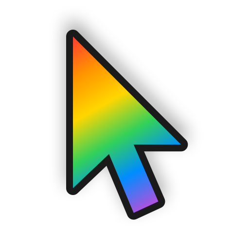
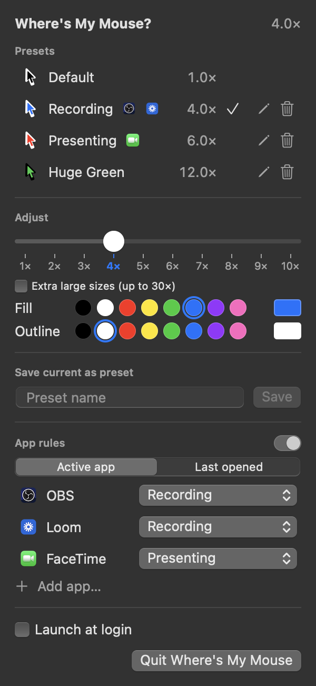

# Where's My Mouse?

<p align="center">
  
</p>

A native macOS menu bar app for managing pointer size and color, for when you (or everyone watching your screen) can't find the mouse. Make the pointer bigger (up to 15×), change its fill and outline colors, and switch between presets in one click, live, without opening System Settings.


## Features

- **Size from 1× to 10×**: past System Settings' 4× limit, applied live as you drag. Tick **Extra large sizes** for up to 15×.
- **Fill and outline colors**: quick swatches, or any color from the color picker.
- **Presets**: starts with just Default; save the current pointer as your own (e.g. a big blue one for recording), then rename, update, or delete it.
- **App rules**: pick any app and a preset; while that app is open, the pointer switches to it (e.g. OBS → blue, Loom → orange). The most recently opened app wins; with none open, it's back to Default.
- **Launch at login**: and sizes above 4× are re-applied when the app starts.



## What it's for

A tiny pointer is fine when you're the only one looking at the screen. It gets lost as soon as someone else is watching, or when the screen is big, busy, or compressed.

- **Screen recordings and tutorials.** Loom, QuickTime, OBS, ScreenFlow, Descript: viewers follow the pointer, and at normal size it vanishes, especially once the video is scaled down or cropped for social.
- **Live demos and presentations.** Projectors and conference screens make the default pointer unreadable from the back of the room. One click to a big red pointer, one click back.
- **Screen sharing on calls.** Zoom, Meet, and Teams compress your screen, and small pointers smear into the background. "Do you see where I'm pointing?" stops being a question.
- **Teaching, pair programming, and streaming.** Students, teammates, and viewers can follow along without you narrating every click.
- **Product videos and App Store previews.** A consistent, branded pointer color looks deliberate in marketing footage.
- **Usability testing.** Recordings of test sessions are much easier to review when you can see what the participant is aiming at.
- **Low vision and tired eyes.** Bigger, higher-contrast pointers help anyone who loses the pointer, without digging through Accessibility settings each time.
- **Big, high-resolution, or multi-monitor setups.** Find the pointer instantly on a 5K display or across three screens.
- **Dark mode and busy backgrounds.** A light or colored pointer stays visible on dark apps, photos, maps, and video editors.
- **Helping someone remotely.** Make the pointer obvious when you're guiding a family member or customer through their own Mac.

Presets make the switching fast: keep "Default" for everyday work, and flip to your own recording or presenting preset right before you hit record or share. App rules can even do it for you while a recording app is open.

## Installation

### Requirements

- macOS 13.0 (Ventura) or later, Apple Silicon or Intel

### Download

1. Download `WheresMyMouse.zip` from the [latest release](https://github.com/andrewkamphey/WheresMyMouse/releases/latest), or the [nightly build](https://github.com/andrewkamphey/WheresMyMouse/releases/tag/nightly) for the newest commit.
2. Unzip it and drag **Where's My Mouse.app** into **Applications**.
3. Open it. The app isn't notarized by Apple, so the first launch is blocked:
   - Click **Done** on the warning, then go to **System Settings → Privacy & Security** and click **Open Anyway** next to Where's My Mouse.
   - Or run once in Terminal: `xattr -dr com.apple.quarantine "/Applications/Where's My Mouse.app"`
4. Look for the pointer icon in your menu bar.

### Allow color changes

Size works right away. Colors need **Full Disk Access**, because macOS only lets apps with it change the accessibility pointer settings. The menu shows a banner with buttons until it's granted:

1. **System Settings → Privacy & Security → Full Disk Access**
2. Click **+**, choose **Where's My Mouse** in Applications, and turn it on.

### Build from source

Needs only the Xcode Command Line Tools (`xcode-select --install`), not Xcode.

```bash
git clone https://github.com/andrewkamphey/WheresMyMouse.git
cd WheresMyMouse
./scripts/setup-signing.sh   # optional, once per Mac: keeps Full Disk Access across rebuilds
./build.sh --install         # builds, copies to /Applications, launches
```

`./build.sh` alone puts the app at `dist/Where's My Mouse.app`. `ARCH=universal ./build.sh` builds for both Apple Silicon and Intel.

## How it works

| Feature | How | Permission |
|---|---|---|
| Size | `CGSSetCursorScale` (private CoreGraphics). Goes past System Settings' 4× limit up to 15× (the window server ignores 16× and above; Apple's own redraw code caps at 10×, so the app re-applies the size after color changes); the app saves up to 4× to the system and re-applies larger sizes on launch | none |
| 16–30× | A click-through window draws the pointer and follows the mouse; the real pointer is hidden (`SetsCursorInBackground` + `CGDisplayHideCursor`). Always an arrow (no hand or text cursor) | none |
| Fill / outline color | `_AXInterfaceSetCursorColorFill/Outline` to save, then `AXFCursorRegisterAll` to redraw the pointer images (private HIServices / AccessibilityFoundation, same calls System Settings uses) | **Full Disk Access**: macOS rejects writes to `com.apple.universalaccess` without it |

These are private macOS APIs, so a future macOS update could break them.

**Signing.** `scripts/setup-signing.sh` creates a self-signed "WheresMyMouse Self-Signed" certificate in your login keychain, and `build.sh` signs with it automatically. That gives your build a stable identity, so Full Disk Access survives rebuilds. Without it, builds are ad-hoc signed and you re-grant Full Disk Access after every build. Override with `SIGN_IDENTITY="Developer ID Application: …"`.

## Project structure

```
WheresMyMouse/
├── Sources/
│   ├── WheresMyMouseApp.swift   # App entry, MenuBarExtra, menu bar icon
│   ├── CursorController.swift   # Private API calls for size, color, permission check
│   ├── OverlayPointer.swift     # The drawn pointer for 16–30×
│   ├── PointerStore.swift       # State, presets, app rules, launch at login
│   ├── Preset.swift             # Preset, app rule and color models
│   └── MenuView.swift           # The menu UI
├── Resources/                   # Info.plist, AppIcon.icns
├── scripts/
│   ├── setup-signing.sh         # Local signing certificate
│   ├── make_icon.swift          # Draws the app icon
│   ├── snapshot-menu.sh         # Renders the menu to docs/menu*.png
│   └── make_social.swift        # Draws docs/social-preview.png
├── spike/                       # The experiments that proved each approach
└── build.sh
```

## License

MIT License. See [LICENSE](LICENSE).
