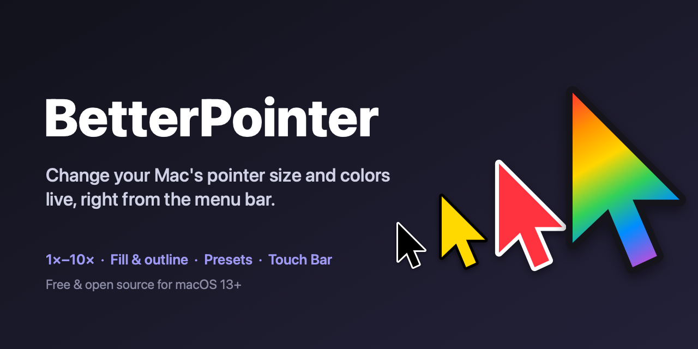

# BetterPointer



A macOS menu bar app (macOS 13+) that changes the system pointer's size (1–10×), fill color, and outline color live, without opening System Settings.

- Built-in presets: Default, Large, High Contrast, Presentation
- Custom presets: save, rename/update, delete (stored in UserDefaults)
- Touch Bar: pin any preset to show it in the Control Strip's BetterPointer button
- Launch at login

## Build

Needs only the Command Line Tools (no Xcode).

```bash
./scripts/setup-signing.sh   # once per Mac: local signing certificate
./build.sh             # builds dist/BetterPointer.app
./build.sh --install   # builds, copies to /Applications, launches
ARCH=universal ./build.sh
```

## Permissions

| Feature | How | Permission |
|---|---|---|
| Size | `CGSSetCursorScale` (private CoreGraphics). Goes past System Settings' 4× limit up to macOS's real 10× cap; the app saves up to 4× to the system and re-applies larger sizes on launch | none |
| Fill / outline color | `_AXInterfaceSetCursorColorFill/Outline` to save, then `AXFCursorRegisterAll` to redraw the pointer images (private HIServices / AccessibilityFoundation, same calls System Settings uses) | **Full Disk Access**: macOS rejects writes to `com.apple.universalaccess` without it |
| Touch Bar | private system-modal Touch Bar + Control Strip calls | none |

Run `scripts/setup-signing.sh` once per Mac. It creates a self-signed "BetterPointer Self-Signed" certificate in your login keychain, and `build.sh` signs with it automatically. That gives the app a stable identity, so Full Disk Access survives rebuilds. Without it, builds are ad-hoc signed and you must remove and re-add BetterPointer in Full Disk Access after every build. Override with `SIGN_IDENTITY="Developer ID Application: …"`.

The social preview is generated by `swift scripts/make_social.swift`. The icon is generated by `swift scripts/make_icon.swift && iconutil -c icns build/AppIcon.iconset -o Resources/AppIcon.icns`.

## Layout

- `Sources/CursorController.swift`: private API calls for size, color, and the permission check
- `Sources/PointerStore.swift`: state, presets, Touch Bar pins, launch at login
- `Sources/TouchBarController.swift`: Control Strip button and preset bar
- `Sources/MenuView.swift`: the menu UI
- `spike/`: the experiments that proved each approach
